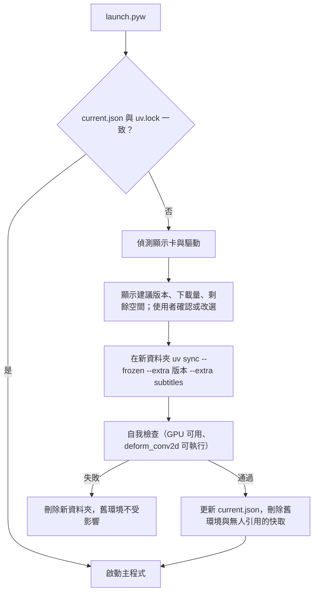

# 架構與發佈流程（Windows 安裝版）

本文說明 Windows 安裝版如何運作，以及一個安裝檔如何建置與驗證。macOS 的打包路線不在本文範圍，見 [macOS 安裝說明](docs_macos_setup.md)。

## 概念

安裝檔只含程式本身，不含 torch。第一次開啟時，程式偵測顯示卡，用 `uv` 依鎖定檔（`uv.lock`）下載對應的 torch，這個選擇稱為「版本」（flavor），對應 `pyproject.toml` 的 uv extra。好處：安裝檔小、torch 不用自己存放、更新程式時 torch 沒變就不重下。

### 版本與支援範圍

版本定義集中在 `src/oh_streamer/runtime_env/flavors.py`（`in_lock` 表示 `uv.lock` 有該 extra，`offered` 表示目前開放安裝）。

| 版本 | torch 來源 | 目標顯示卡 | 推論裝置 | 編碼器 | 目前狀態 |
| --- | --- | --- | --- | --- | --- |
| `nvidia`（cu128） | download.pytorch.org/whl/cu128 | GTX 16 系列、RTX 20～50 系列，驅動 570 以上 | `cuda` | NVENC | 開放安裝，在 lock 內 |
| `cpu` | download.pytorch.org/whl/cpu | 任何電腦 | `cpu` | x264／x265 | 在 lock 內，只供開發測試，不開放 |
| `intel`（xpu） | download.pytorch.org/whl/xpu | Arc、Core Ultra 內顯 | `xpu` | QSV | 未開放，不在 lock 內 |
| `amd`（ROCm） | AMD 官方 Windows wheel | RX 7000、RX 9000 等 | `cuda`（HIP） | AMF | 未開放，不在 lock 內，實驗性 |

`intel`、`amd` 不放進同一份 lock：只要 lock 含 `intel` extra，不帶 extra 的基礎環境就會解析成帶 xpu 執行庫的 torch，環境暴增。這兩個版本日後需各自獨立的 `pyproject.toml`／lock，並先在實體卡驗證（含裝置選擇、編碼器、字幕環境偵測對 xpu／ROCm 的支援與對應的自我檢查），才會把 `offered` 打開。偵測不到任何開放的版本時，設定畫面顯示「暫不支援這台電腦的顯示卡」，列出支援的卡並提供診斷包匯出。

### 依賴與鎖定

- `requires-python = "==3.13.*"`；`uv.lock` 限定 `win32` + `AMD64`，套件皆有 SHA256。
- 基礎依賴（不含 torch）寫在 `[project].dependencies`；`nvidia`／`cpu` extra 含 torch、torchvision、torchaudio（三者同版）；`subtitles` extra 含本機字幕套件（transformers、accelerate、silero-vad、opencc 等，釘版）。
- 兩個 PyTorch index 設為 `explicit = true`，`cpu` 與 `nvidia` 互斥（`conflicts`）。
- ultralytics、accelerate 等會無條件依賴 torch，所以 lock 內另有一份 PyPI 的 torch 作後備；基礎環境因此必須帶三個 `--no-install-package torch|torchvision|torchaudio`。
- 修復引擎 lada 以固定 commit 打成 wheel（`packaging/build_lada_wheel.py`：`git archive` 匯出、固定 `SOURCE_DATE_EPOCH`，可重現），放在 `packaging/wheels/`，使用者電腦不需要 git。`engines/lada/compat.py` 記錄已驗證的 lada 版本與 commit。
- 對 lada 的修補在執行期做（`engines/lada/runtime_patches.py`：環境變數預設值與 NMS 預設閾值），不改 site-packages，因此不會汙染 uv 快取的 hardlink 檔。

## 安裝後的資料夾

分成程式資料夾與使用者資料夾，名稱都是 `oh_streamer`。

```
%LOCALAPPDATA%\Programs\oh_streamer\     程式資料夾（安裝時可選位置）
  app\            程式碼、pyproject.toml、uv.lock、lada wheel、launch.pyw、
                  tools\（ffmpeg、mpv）、model_weights\、third_party\rife
  python\         內嵌 Python（python-build-standalone）與 VC++ runtime DLL
  uv.exe
  uv-cache\       uv 快取（固定在程式資料夾，與環境同一顆硬碟才能 hardlink）
  envs\<lock 雜湊前 8 碼>\                 基礎環境（無 torch）
  envs\<lock 雜湊前 8 碼>-<版本>-<n>\      GPU 環境，每次安裝都是新資料夾
  logs\           uv 輸出與診斷用紀錄
  current.json    目前使用的環境、版本、lock 雜湊，以及待刪的舊環境
%LOCALAPPDATA%\oh_streamer\              使用者資料：佇列、設定、字幕模型與下載內容
```

環境資料夾用短雜湊命名，以避開 Windows 260 字元路徑上限。使用者資料夾與開發環境共用，兩邊不要同時開。佈局邏輯在 `runtime_env/layout.py`。

## 首次開啟與環境管理

捷徑執行內嵌 Python 的 `pythonw.exe launch.pyw`，不使用自訂 exe。`launch.pyw`（只用標準函式庫）負責：

1. 必要時用 `uv sync --frozen`（帶三個 `--no-install-package`）建立基礎環境。
2. 設定環境變數（`OH_STREAMER_INSTALL_ROOT`、`OH_STREAMER_PROJECT_ROOT`、`LADA_MODEL_WEIGHTS_DIR`，PATH 加入 `tools`、`tools\mpv`）。
3. 比對 `current.json` 指向的環境與目前 `uv.lock` 的雜湊；一致就啟動主程式，否則進入設定模式。

設定模式是主程式的一個 pywebview 畫面，跑在基礎環境：



- **偵測**（`gpu_detect.py`）：以 `Win32_VideoController` 取得廠牌、型號、驅動；N 卡再用 `nvidia-smi` 讀運算能力判斷世代；獨顯優先，Intel 內顯加 N 卡的機器不選 `intel`。
- **安裝**（`installer.py`、`provision.py`）：uv 環境變數為 `UV_PROJECT_ENVIRONMENT`、`UV_CACHE_DIR`、`UV_NO_CONFIG=1`、`UV_SYSTEM_CERTS=1`；基礎環境用 `--inexact` 避免重跑時移除已裝的 torch；每次裝進新資料夾（uv venv 寫的是絕對路徑，不能裝完再改名）。安裝前檢查磁碟空間（安裝峰值約 9 GB），並確認沒有其他 Oh Streamer 行程在跑（`app_running.py`、`env_guard.py`）。
- **進度**（`download_progress.py`）：先 dry-run 列出要下載的套件與大小，再比對已寫入的檔案推算已下載量、速度與剩餘時間；量不到時只顯示「正在下載」。此邏輯依賴 uv 的輸出格式，升級隨附的 uv 時要重驗。
- **下載中斷**：已完成的 wheel 重試時不重下；uv 不續傳單一檔案，沒下完的 torch（cu128 約 3.2 GiB）會整個重下，失敗畫面有說明。
- **靜態庫清理**（`torch_prune.py`）：刪除 torch 的 `lib\*.lib`（約 2.7 GB，只有編譯擴充才用到）及 uv 快取中同一檔案的 hardlink 副本。快取被清掉或 `--reinstall` 後會回來，需再刪一次。
- **重裝與切換版本**：主程式設定的「重新偵測／切換版本」與開始選單的「修復與診斷」（`launch.pyw --setup`）走同一流程。舊環境不保留回滾，成功後立即刪除（`env_cleanup.py`）；沒變的套件從快取 hardlink，不重下也不多佔空間。設定畫面可匯出診斷包（日誌、uv 輸出、偵測結果）。
- 主程式本身不 import torch（只有 `player/oh_player.py`、`engines/frame_source.py`、`engines/passthrough/`、`engines/lada/` 需要），所以基礎環境即可啟動設定模式。

## 字幕與模型

- 本機字幕用 HF `transformers` + torch，翻譯用外部執行檔 `llama-server`；套件在 `subtitles` extra，與修復共用同一個執行環境。
- 修復模型與 RIFE 權重隨安裝檔附帶（附授權檔）。字幕模型與 `llama-server` 不附帶，使用者在 設定 → 字幕 → 本機 首次啟用時下載，下載前顯示大小並確認。
- 下載器 `src/oh_streamer/subtitles/model_download.py`：目錄內每個檔案固定 revision（Hugging Face commit、llama.cpp release tag）、大小與 SHA256；HTTP Range 續傳、取消保留 `.part`、核對通過才放到正式位置、zip 安全解壓、磁碟空間檢查。`llama-server` 目前為 Windows CUDA 版。
- 安裝版（有 `OH_STREAMER_INSTALL_ROOT`）預設把模型放在 `%LOCALAPPDATA%\oh_streamer\subtitle_models`，字幕 worker 使用目前環境的 python；設定與 `OH_STREAMER_SUBTITLE_*` 環境變數可覆蓋。
- 模型的釘版目錄在 `model_download.py`；字幕 Python 套件的釘版在 `pyproject.toml` 的 `subtitles` extra。
- 非 NVIDIA 版本（尚未開放）的字幕降級方向：雲端 ASR；翻譯用雲端或 Vulkan 版 `llama-server`；`cpu` 全雲端。

## 安裝程式與更新

- **Inno Setup**（`packaging/installer/oh_streamer.iss`）：`PrivilegesRequired=lowest`，免管理員；`AppId` 固定，覆蓋安裝才認得舊版；預設 `{userpf}\oh_streamer`，可變更位置（擋掉需管理員的位置與過長路徑）；建立捷徑（指向 `pythonw.exe launch.pyw`，不跳黑窗）與「修復與診斷」捷徑。
- VC++ runtime 的 DLL 放在 `python\`（從官方 redistributable 內嵌的 cab 取出，不執行該安裝程式），不需管理員權限。安裝結束時偵測 WebView2，缺少就執行內嵌的 Microsoft bootstrapper；失敗不中斷安裝。
- **解除安裝**：移除安裝程式自己放的檔案與 `logs`；torch 環境與 uv 快取、已下載的字幕模型、使用者資料三項分別詢問，預設保留，供重裝使用。程式執行中會先被要求關閉。
- **更新**：下載新安裝檔覆蓋安裝。啟動時比對 lock：沒變不動 torch；有變就依上節流程在新資料夾安裝（只下載有變的套件）。
- **檢查更新**（`src/oh_streamer/update_check.py`）：設定畫面的手動按鈕，只在按下時查 GitHub Releases 的最新版，有新版就顯示內容與前往下載頁的連結，不在程式內下載或覆蓋安裝。目前沒有自動更新與程式碼簽章；未簽章的安裝檔會被 SmartScreen 提示一次。

## 如何建置一個發佈版

資源清單在 `packaging/installer_inputs.json`：每項資源有網址、大小、SHA256 與來源／授權說明，內容包括 python-build-standalone、`uv.exe`、ffmpeg、mpv、VC++ redistributable、lada 與 RIFE 的模型權重及授權檔、WebView2 bootstrapper。

```
python packaging/build_installer.py stage --out <資料夾>          # 下載並核對資源、組裝 stage、寫 build manifest
python packaging/build_installer.py verify-stage <資料夾>         # 核對 stage 內每個檔案
python packaging/build_installer.py installer --out <資料夾>      # 先 stage 與 verify-stage（--skip-stage 可略過），再呼叫 ISCC 編譯
python packaging/build_installer.py check-iss                     # 用假 stage 驗證 .iss 可編譯，不下載資源（CI 使用）
```

安裝檔檔名由 `branding.js` 的產品名稱與程式版本組成；build manifest 記錄每個檔案的大小與 SHA256、程式版本、`uv.lock` 雜湊與 git 來源（`build_provenance.py`）。需要 Inno Setup 的 `ISCC.exe`。更新釘版資源時，同步更新該項的 `url`、`size`、`sha256` 與授權說明。`.github/workflows/packaging-checks.yml` 跑只需標準函式庫的測試模組與 `check-iss`。

發佈當天的步驟見 [docs_release_checklist.md](docs_release_checklist.md)。

## 發佈前驗證

每個版本在至少一張對應的實體顯示卡、乾淨的 Windows 帳號上跑完下列各項；任一項失敗，該版本不發佈。實驗性版本只要求前五項。

| 項目 | 做法 | 通過條件 |
| --- | --- | --- |
| 安裝 | 執行安裝檔 | 免管理員，捷徑正確 |
| 第一次開啟 | 照畫面走完 | 自動選中正確版本，自我檢查通過，載入權重不報錯、無遙測連線 |
| 中斷續裝 | 下載途中斷網再重開 | 已完成的 wheel 不重下，不留壞環境，原環境不受影響 |
| 裝置 | 資訊面板或 `portability_doctor.py` | 實際使用 GPU；lada 版本為已驗證 |
| 即時播放 | 播放短片約 1 分鐘 | 不崩潰、有修復畫面 |
| 佇列匯出 | 匯出同一支短片 | 可播放，編碼器是該廠牌的硬體編碼器 |
| 字幕 | 雲端字幕一次；`nvidia` 再跑本機字幕 | 依「字幕與模型」一節的降級方向運作，不因缺套件崩潰 |
| 效能檢測 | 跑一次 | 有結果 |
| 更新 | 覆蓋安裝（lock 不變） | 不重下 torch，設定與佇列保留 |
| 檢查更新 | 按按鈕（真實或假回應） | 有新版時顯示內容與連結；無新版或無網路有清楚訊息 |
| 解除安裝 | 勾選與不勾選各一次；程式執行中也試一次 | 選擇刪除的項目清乾淨，未勾選的保留，執行中會先關閉 |
| 路徑 | 使用者名稱含中文、空格、很長 | 全程正常，無路徑過長錯誤 |

## 已知限制

- 第一次開啟要下載約 5 GB（以 torch 為主），網路慢時需等待；目前沒有離線完整包。GitHub release 單檔上限 2 GiB，未來若做離線包需切檔。
- 瀏覽器解析功能使用系統 Edge／Chrome（Playwright），不附 Chromium。
- Windows 10 上 WebView2 能否免管理員自動安裝，取決於 bootstrapper 的行為，未在乾淨 Win10 驗證。
- 修復引擎透過 `engines/` 介面接入（目前為 lada 與 passthrough），可替換，細節見程式碼。
